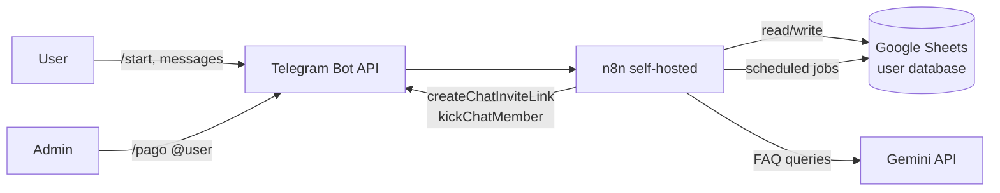

# Telegram Membership Bot — Trial, FAQ & Premium Access Automation

A production-grade Telegram bot that automates the full lifecycle of a paid subscription channel: user onboarding, trial management, AI-powered FAQ, tutorials, expiration, and admin-driven payment activation.

Built end-to-end in **n8n** (self-hosted) with **Gemini** for natural-language FAQ, **Google Sheets** as the user database, and the **Telegram Bot API** as the user-facing layer. Deployed for a real client running a trading-signals premium channel — handled trial-to-paid conversion and member retention without manual intervention.

> Stack: n8n · Telegram Bot API · Google Sheets · Gemini API · JavaScript

---

## Why this exists

Premium Telegram channels usually depend on a human admin to: invite trial users, answer the same questions ten times a day, remember who's on day 27 of their trial, kick people who didn't pay, and manually activate members who did. That doesn't scale and it leaks revenue.

This bot replaces all of that with a deterministic, auditable workflow. The admin only intervenes for one thing: confirming a payment with `/pago @username`. Everything else runs on schedule.

---

## What it does

| Capability | Description |
|---|---|
| **Onboarding** | User hits `/start` → bot registers them in Google Sheets, generates a single-use invite link to the premium channel, and sends it as a button. |
| **AI-powered FAQ** | Free-text questions (price, payment, how-to, broker, signals frequency) are answered by Gemini with grounded context. Questions outside scope (financial advice, payment confirmation) are routed to a human admin. |
| **Visual tutorials** | "How do I copy a signal?" / "How do I load funds?" → bot replies with step-by-step screenshots. |
| **Trial lifecycle** | Day 15 reminder, day 27 urgency message, day 30 auto-expel + status update — all idempotent (anti-duplicate marking in the sheet). |
| **Admin payment activation** | `/pago @username` from an authorized admin marks the user as paid, sets payment date, and schedules 30-day renewal. |
| **Paid-user protection** | Active members are immune from trial reminders and day-30 expulsion. |

---

## Architecture



The system is decomposed into **three independent n8n workflows**, each with a single responsibility:

### 1. Onboarding & FAQ (`workflows/onboarding-and-faq.json`)
Trigger: Telegram message received.
- Reads user row from Google Sheets by `user_id`
- **New user** → append row (user_id, username, ingreso date, status=`active_trial`) → generate Telegram invite link (`createChatInviteLink`, `member_limit=1`) → send welcome message with inline button
- **Existing user** → route message to Gemini with FAQ context → reply with answer, or hand off to admin if out-of-scope

### 2. Trial Reminders (`workflows/trial-reminders.json`)
Trigger: Daily schedule (9:00 local time).
- Reads all rows from Sheets, computes days since `fecha_ingreso`
- `IF days == 15 AND avisado_15 != true` → send mid-trial reminder, mark `avisado_15`
- `IF days == 27 AND avisado_27 != true` → send urgency reminder, mark `avisado_27`
- Idempotent: a user never receives the same reminder twice.

### 3. Trial Expiration (`workflows/trial-expiration.json`)
Trigger: Daily schedule.
- Filters users where `days_since_ingreso >= 30 AND status == active_trial`
- Calls `kickChatMember` to remove from premium channel
- Updates row status to `trial_vencido`
- Skips users with status `membresia_activa` (paid users are protected).

### Admin command `/pago @username`
Implemented as a branch inside workflow #1: detects the command, checks the sender against an admin allowlist, updates the target user's row (`status=membresia_activa`, `fecha_pago=now`, `fecha_vencimiento=now+30d`), and sends a confirmation message.

---

## Why these design choices

- **n8n over a Node/Python bot from scratch.** Membership management is plumbing — webhooks, scheduled jobs, state transitions over a small table. n8n makes the plumbing visual and the state changes auditable per execution. A custom bot would have been faster to write the first version of, slower to debug a month in.
- **Google Sheets as the database.** The client needed to read and edit users manually. A real DB would have required building a small admin panel. Sheets gave them a UI for free.
- **Gemini Flash, not GPT or Claude.** Free tier, low-latency, good enough for short FAQ answers grounded in a 500-token system prompt. Cost-per-message matters when you're answering hundreds of questions a month.
- **Idempotency via "already-sent" flags in the sheet.** No event-sourcing, no queue — just a column per reminder. If the daily job runs twice (Railway restarts, n8n redeploy), users still only get one message.
- **Single-use invite links instead of a shared link.** Prevents leaked links from being passed around. Each user gets their own one-time link tied to their record.

---

## Project structure

```
.
├── workflows/                  # Sanitized n8n workflow JSONs (no credentials)
│   ├── onboarding-and-faq.json
│   ├── trial-reminders.json
│   └── trial-expiration.json
├── docs/
│   ├── architecture.md         # Detailed architecture & data model
│   ├── faq-content.md          # The actual FAQ knowledge base fed to Gemini
│   └── screenshots/            # Bot in action
├── .env.example                # All required environment variables
├── .gitignore
└── README.md
```

---

## Setup

> This repo is the **system blueprint**, not a one-click installer. n8n workflows reference credentials configured inside n8n itself.

1. **Spin up n8n** — self-hosted (Docker, Railway, Hetzner) or n8n Cloud. Tested on Railway and self-hosted Docker.
2. **Configure credentials in n8n:**
   - Telegram Bot (`TELEGRAM_BOT_TOKEN` from @BotFather)
   - Google Sheets OAuth (for read/write to the user database)
   - Gemini API key
3. **Create the Google Sheet** with these columns:
   `user_id | username | first_name | last_name | fecha_ingreso | dias_en_grupo | estado | fecha_pago | fecha_vencimiento | avisado_15 | avisado_27`
4. **Import workflows:** in n8n, Import from File → select each JSON in `workflows/`. Re-bind credentials after import.
5. **Set the admin allowlist:** edit the `IF` node in workflow #1 to include the Telegram user IDs allowed to run `/pago`.
6. **Activate workflows.** Send `/start` to your bot from a test account to verify onboarding.

See [`docs/architecture.md`](docs/architecture.md) for the full data model and decision log.

---

## Status

Built and deployed for a paying client managing a trading-signals premium channel. Handled the full trial → paid pipeline. **System validated end-to-end and shipped to production.**

---

## License

MIT. See [LICENSE](LICENSE).
