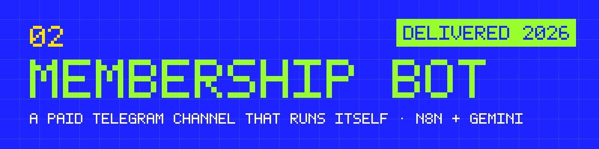
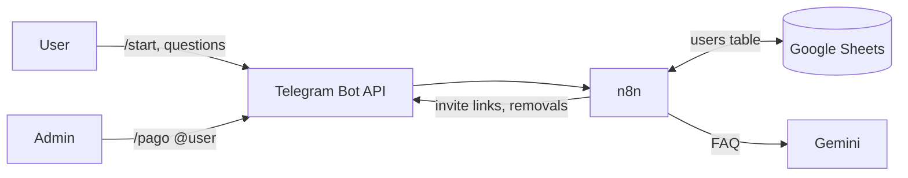

**A paid Telegram channel that runs itself.** New members get a personal invite, a free trial, answers to their questions and reminders before it ends. People who don't pay are removed. The admin only does one thing: confirm payments.

`n8n` · `Telegram Bot API` · `Gemini` · `Google Sheets` · `JavaScript`

> **En español:** bot para un canal pago de Telegram. Da de alta a cada persona con un enlace único, le responde las preguntas frecuentes con IA, le avisa antes de que termine la prueba y saca a quien no pagó. El administrador solo confirma pagos con `/pago @usuario`. Lo hice para un cliente en 2026.

## The problem

A premium Telegram channel usually depends on one admin who invites every new user, answers the same five questions all day, keeps track of who's on day 27 of their trial, kicks out whoever didn't pay and activates whoever did. It doesn't scale, and every forgotten step is lost money.

## What I built

| Part | What it does |
|---|---|
| **Onboarding** | `/start` registers the user and sends a single-use invite link to the channel. |
| **AI FAQ** | Free-text questions (price, payment methods, how to copy a signal) are answered by Gemini from a fixed knowledge base. Anything outside that scope, like financial advice or "did my payment arrive?", goes to the admin. |
| **Tutorials** | "How do I load funds?" gets a step-by-step answer with screenshots. |
| **Trial lifecycle** | Reminder on day 15, urgency message on day 27, removal on day 30. A user never gets the same message twice. |
| **Payments** | `/pago @user` from an authorized admin activates the membership for 30 days. Paying members are never reminded or removed. |

## How it works

Three n8n workflows, one job each:

1. **Onboarding & FAQ** (`workflows/onboarding-and-faq.json`): runs on every message. New user → register, invite link, welcome. Known user → tutorial, FAQ answer or admin command.
2. **Trial reminders** (`workflows/trial-reminders.json`): runs daily at 9:00 and sends the day-15 and day-27 messages.
3. **Trial expiration** (`workflows/trial-expiration.json`): runs daily, removes expired trials and marks them in the sheet.

The data model, the state transitions and the n8n settings that matter are in [`docs/architecture.md`](docs/architecture.md). The knowledge base Gemini answers from is in [`docs/faq-content.md`](docs/faq-content.md).

## Decisions

- **n8n instead of a bot written from scratch.** This is plumbing: messages, scheduled jobs and a small table that changes state. In n8n every run can be inspected step by step, which makes it easy to debug a month later.
- **Google Sheets as the database.** The client wanted to see and edit users by hand. Sheets gave them that without building an admin panel.
- **Gemini Flash.** Free tier, fast, and enough for short answers from a short knowledge base.
- **A "sent" column per reminder.** If a daily job runs twice, nobody gets the message twice. Two extra columns instead of a queue.
- **Single-use invite links.** A link that leaks can't be shared: each one works once and is tied to one user.

## How I built it

I build with AI tools (Claude Code, Codex). The AI wrote most of the node configuration and code. My part was agreeing the requirements with the client, designing the user states and the decisions above, and testing each workflow before handing it over.

## Run it

This repo is the blueprint, not a one-click installer: n8n keeps credentials inside n8n.

1. Run n8n (self-hosted with Docker, Railway, or n8n Cloud).
2. In n8n, create the credentials: Telegram bot token (from @BotFather), Google Sheets and Gemini. The variables are listed in [`.env.example`](.env.example).
3. Create a sheet with these columns: `user_id · username · first_name · last_name · fecha_ingreso · dias_en_grupo · estado · fecha_pago · fecha_vencimiento · avisado_15 · avisado_27`.
4. Import the three files in `workflows/` and reconnect the credentials.
5. Put the admin's Telegram ID in the `IF` node of the first workflow.
6. Activate the workflows and send `/start` from a test account.

## Status

Delivered to a paying client in May 2026, for a trading-signals channel. The client ended up not launching the channel, so there's no real-usage data.

## What I'd do next

- Connect a payment provider so `/pago` isn't needed.
- Keep a payment history instead of only the last payment.
- Move users to Postgres past a few hundred rows.
- A small dashboard with active trials, conversion and churn.

---

02 · Part of the work of <a href="https://github.com/ayrtongenovesi">Ayrton Genovesi</a>, Rosario, Argentina. I build with AI and make sure it works.
